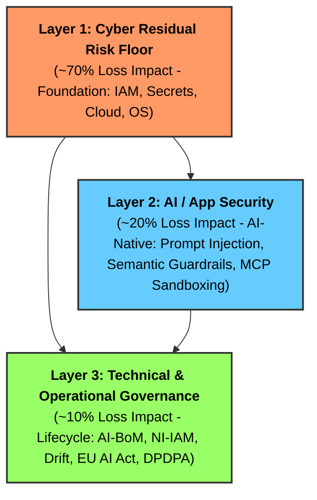
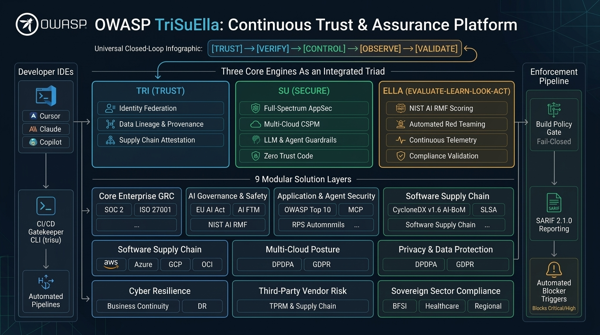

# 📘 TriSuElla Framework — the WHAT

> **Rules, architecture and guides.** Documents only: no executable code lives in this folder.
> The software that enforces them is in [`../solution/`](../solution/README.md).

| Start here | What it is |
|---|---|
| [Charter](rules/CHARTER.md) | Philosophy, severity scale, binary enforcement principle |
| [Master rulebook](rules/TRISUELLA_MASTER_RULES_AND_CHECKS.md) | Every `TRISU-*` rule, by domain family |
| [Enforcement map](rules/ENFORCEMENT-MAP.md) | Which rules the scanner automates today (generated) |
| [Workflow prompt](rules/workflow/core-workflow.md) | The baseline instructions loaded into an AI coding tool |
| [Extensions](rules/rule-details/extensions/) | Opt-in rule packs (cloud, AI-agentic, compliance, OSS ...) |
| [Architecture](architecture/Unified-Trust-Risk-Compliance-Architecture.md) | The 9 layers, TRI-SU-ELLA engines, crosswalks |
| [Guides](guides/developer/faq.md) · [Prompts](guides/prompts/README.md) | Developer guides and the prompt library |
| [Reference data](reference-data/) | Source regulatory material (RBI, ISO 42001, CSA AICM ...) |

## 🔗 How the framework meets the solution

A rule is only as strong as its enforcement. The link between the two folders is the **rule ID**:

```
framework rule  ──(TRISU-ZTC-05)──▶  solution check (trisu audit)  ──▶  evidence (SARIF, AI-BoM)
```

Each rule is enforced in one of two ways:

- **Automated**: scanner code emits a finding tagged with the rule ID.
- **Process**: an AI-assistant directive, human review, or manual evidence collection.

The generated [**enforcement map**](rules/ENFORCEMENT-MAP.md) shows which is which for all rules.
CI regenerates it (`trisu map --check`), so it cannot drift from the code.

---

## 🏛️ Executive Overview

The **TriSuElla-AIDLCA Framework** is the **Unified Control-and-Validation Layer** across conventional systems, GenAI applications, and autonomous multi-agent ecosystems. Rather than treating compliance and security as disjointed checklists, TriSuElla provides a unified architecture connecting **SOC 2, ISO/IEC 27001, NIST AI RMF (with GenAI Profile NIST.IR.8596), EU AI Act, DPDPA, and the OWASP suite (OWASP Top 10 for LLM Applications 2025, Agentic AI, API, Web, Mobile)**.

### The TriSuElla Operating Formula
$$\text{Trust the component} \longrightarrow \text{Verify the component} \longrightarrow \text{Control its authority} \longrightarrow \text{Observe its behavior} \longrightarrow \text{Continuously validate the outcome}$$

### The Standards as Evaluation Lenses
Each standard represents an evaluation lens answering a specific trust inquiry:
- **ISO/IEC 27001:2022**: *"Do you have an effective information security management system (ISMS)?"* → Control assessment, risk treatment, continual improvement.
- **SOC 2 Type II**: *"Are relevant controls operating effectively across Security, Availability, Integrity, Confidentiality, Privacy?"* → Automated evidence collection, continuous control monitoring.
- **NIST AI RMF 1.0 & GenAI Profile**: *"Are AI risks governed, mapped, measured, and managed?"* → AI risk identification, empirical red teaming, and drift gates.
- **EU AI Act (2024/1689)**: *"Are the applicable AI regulatory obligations satisfied?"* → High-risk AI classification, Annex IV technical dossiers, and human oversight.
- **OWASP Suite**: *"Can the actual application, LLM, or agent be attacked?"* → Adversarial security testing, prompt sandboxing, and runtime validation.
- **🔱 TriSuElla Core**: *"Can we continuously prove that the system, its components, controls, and AI behavior remain trustworthy?"* → Master Control & Assurance Engine.

### The 8-Stage TriSuElla Operational Pipeline
```
1. GOVERN       --> Policies • Ownership • Accountability • Legal Obligations
2. DISCOVER/MAP --> Assets • Applications • Models • Agents • Data • Vendors
3. ASSESS       --> SOC 2 • ISO 27001 • NIST AI RMF • EU AI Act • DPDPA
4. ATTACK/TEST  --> Red Teaming • Prompt Injection • Excessive Agency • AppSec
5. CONTROL      --> Least Privilege • Semantic Guardrails • Tool ACLs • Dual-Key HITL
6. OBSERVE      --> Runtime Telemetry • Output Anomalies • Model Drift • Audit Logs
7. EVIDENCE     --> Cryptographic Ledger • AI-BoM • SARIF • Compliance Dashboard
8. VALIDATE     --> Independent Verification • Re-test • Continuous Assurance
```

Rooted in the symbolic **Trident (Trishula)** of Nordic and Sanskrit principles:
- 🔴 **SISU (Resilience & Execution)**: Agents execute with deterministic bounds, crash recovery, and safety invariants.
- 🔵 **TILLIT (Trust & Governance)**: Zero Trust ("Never Trust, Always Verify"), cryptographic identity, and tamper-evident audit trails.
- 🟢 **DUGNAD (Collective Collaboration)**: Multi-agent handoffs with mandatory **Dual-Key Human-in-the-Loop (HITL)** approval gates.

---

---

## 🛡️ The 3-Layer Risk-First AI Security Model

TriSuElla structures security investment according to where real-world operational and financial loss occurs:



---

---

## 🏛️ The TriSuElla Continuous Trust Architecture (v3.4.0)



TriSuElla serves as the **master control-and-validation layer** across 9 structured solution layers, powered by the **TRI-SU-ELLA Engine Triad**:

$$\textbf{TRUST} \longrightarrow \textbf{VERIFY} \longrightarrow \textbf{CONTROL} \longrightarrow \textbf{OBSERVE} \longrightarrow \textbf{VALIDATE}$$

```mermaid
graph LR
    subgraph TRI["<b>TRI (Trust)</b>"]
        T1["Identity & IAM<br/>(RFC 8693 / SPIFFE)"]
        T2["Data Provenance<br/>(CycloneDX AI v1.6)"]
        T3["Supply Chain<br/>(SLSA / Cosign)"]
    end

    subgraph SU["<b>SU (Secure)</b>"]
        S1["Cybersecurity & Cloud<br/>(CSPM / CIS / Zero Trust)"]
        S2["AppSec & APIs<br/>(OWASP Top 10 / ASVS)"]
        S3["LLM & Agent Security<br/>(MCP Sandboxing / ZTC)"]
    end

    subgraph ELLA["<b>ELLA (Evaluate·Learn·Look·Act)</b>"]
        E1["Risk & Red Teaming<br/>(NIST AI RMF / PyRIT)"]
        E2["Continuous Telemetry<br/>(Drift & Anomaly Alarms)"]
        E3["Audit & Validation<br/>(SOC 2 / ISO 27001 / SARIF)"]
    end

    TRI --> SU
    SU --> ELLA
    ELLA -.->|Closed Feedback Loop| TRI

    style TRI fill:#e8f4fd,stroke:#0969da,stroke-width:2px,color:#000
    style SU fill:#fff8c5,stroke:#9a6700,stroke-width:2px,color:#000
    style ELLA fill:#dafbe1,stroke:#1a7f37,stroke-width:2px,color:#000
```



---

---

## 📊 Summary of Master Rules & Checks (338 Total across 33 Domain Families)

All rules are consolidated in [TRISUELLA_MASTER_RULES_AND_CHECKS.md](rules/TRISUELLA_MASTER_RULES_AND_CHECKS.md):

| Section | Domain / Rule Family | Checks | Primary Standards / Anchors |
| :--- | :--- | :---: | :--- |
| **0–1** | Framework Charter & Core LLMSecOps Lifecycle | 15 | STRIDE-AI, ISO 5259, Cosign, AI-BoM |
| **2** | System Security Baseline (`TRISU-BASE`) | 15 | OWASP Top 10 (2026), API Security |
| **3** | AI & Agentic Security (`TRISU-SEC`) | 22 | OWASP Top 10 for LLM Applications (2025 Standard), Tool Sandboxing |
| **4** | Zero Trust Architecture & Code (`TRISU-TRUST`/`ZTC`) | 22 | CISA ZT Maturity Model, NIST SP 800-207, ASVS |
| **5** | Sensitive Data Security (`TRISU-DATA`) | 10 | DPDPA (India), GDPR, HIPAA, L0–L4 Classification |
| **6–8** | DLCA, Infra (`TRISU-INFRA`), Cloud & Multi-Cloud CSPM (`TRISU-CLOUD`/`CSPM`) | 55 | CIS Benchmarks, Multi-Cloud CSPM (AWS, Azure, GCP, Alibaba, OCI) |
| **9–10** | Regional Compliance & Privacy by Design | 51 | Art. 25 GDPR, RBI Cyber Resilience, NIST SSDF |
| **11–13**| Testing, Checklists & CI/CD Gates | 45 | Garak, PyRIT, SAST, 20-Item Review Checklist |
| **14–20**| Tooling, Maturity Model, KPIs & RBI Sutras | 40 | Sisu-UI, RBI 7 Sutras, ISO 42001 AIMS |
| **21** | **Model Context Protocol Security (`TRISU-MCP`)** | **6** | MCP Schema Sanitization, Recursion Bounds, HITL |
| **22** | **EU AI Act High-Risk Compliance (`TRISU-EUAI`)** | **7** | EU Regulation 2024/1689 (Articles 9–15, CE Gate) |
| **23** | **Agentic Identity & Token Delegation (`TRISU-AIAM`)** | **5** | RFC 8693 Token Exchange, SPIFFE/mTLS, Ephemeral Keys |
| **24** | **Open Source & Supply Chain Security (`TRISU-OSS`)** | **6** | OpenSSF, SLSA v1.0, Lockfile Hash Pinning, CycloneDX v1.6 |
| **25** | **Shadow AI Discovery & Enforcement (`TRISU-SHADOW`)** | **6** | Shadow AI AST Scan, Gateway Bypass Defense, BOM Sync |
| **26** | **Data Literacy & Integrity Governance (`TRISU-DLIT`)** | **8** | ISO 5259, Data Provenance, Vector ACL, Air-Gap Defense |
| **27** | **Core Enterprise GRC: SOC 2 & ISO 27001 (`TRISU-SOC2`/`ISMS`)** | **8** | SOC 2 Type II (CC6.1..CC8.1), ISO/IEC 27001:2022 A.5..A.8 |
| **28** | **AI Risk Management: NIST AI RMF (`TRISU-AIRMF`)** | **6** | NIST AI RMF 1.0 (Govern, Map, Measure, Manage), GenAI NIST.IR.8596 |
| **29** | **Full-Spectrum AppSec Suite (`TRISU-API`/`MOB`/`WEB`)** | **11** | OWASP API Security Top 10, Mobile Top 10, ASVS v4.0, CWE, CISA KEV |
| **TOTAL**| **Consolidated Invariants (237 Unique Rules)** | **338** | **Mandatory Blocking for [CRITICAL]/[HIGH]** |

---

> **How "338" and "237" relate.** The rulebook contains **237 ID-tagged rules** (the unique `TRISU-*`
> identifiers; `trisu rules` counts them). The header index reaches **338** by also counting untagged
> items in sections that carry no rule IDs (checklist items, CI/CD gates, maturity levels, decision-tree
> steps, KPIs, regional mappings). Only the 237 tagged rules can be mapped to enforcement.

---

*Back to the [repository overview](../README.md) · Enforcing software: [`../solution/`](../solution/README.md)*
